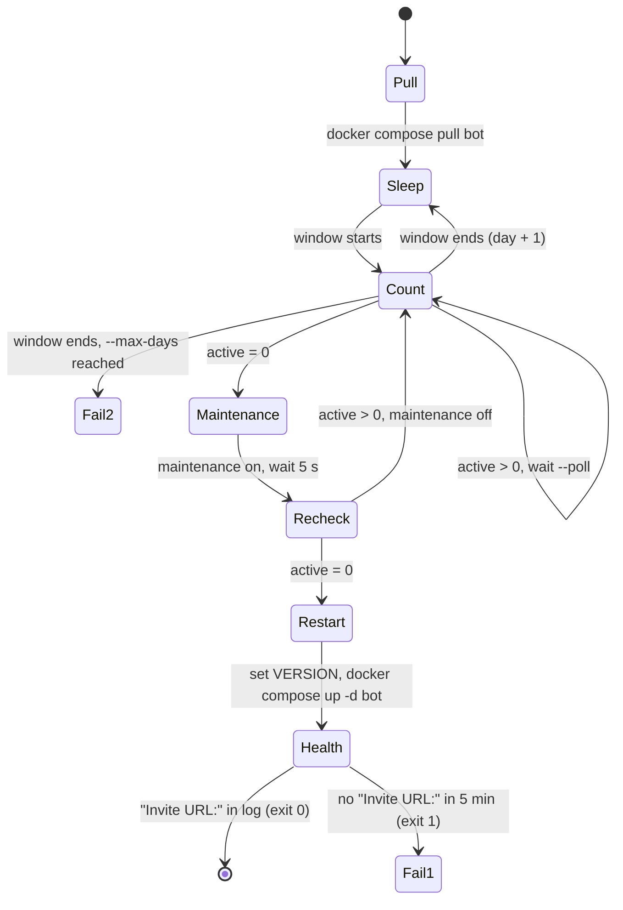

# Deploy script: restart the bot only when no recording is active

Status: draft. Decision record: pawabot/meta#22.

## Goal

A deploy must not stop an active recording. A user must not need to recover a recording after a
deploy.

## Non-goals

- Two bot processes, or a shard handoff. Deferred in meta#22.
- Split and resume (option D). Deferred until the deploy script fails to find a quiet moment
  often (see "When this is not enough").
- Deploys from CI or from the GitLab webhook. The operator starts each deploy.
- Bot code changes. The bot already has everything the script needs.

## What exists

| Part | Where | Note |
|---|---|---|
| `(repl/active-recordings)` | `src/main/clojure/repl.clj` | `:active` has one entry for each guild with a voice connection |
| `(repl/maintenance! on?)` | `src/main/clojure/repl.clj` | In memory only. `/record` answers "maintenance" while it is on |
| nREPL | prod: `127.0.0.1:7888` on `pawa.im` | Published by `docker-compose.yml` |
| Image tag | `VERSION=` in `/opt/pawa/.env` | Example: `2.17.0-82bfd798` |
| `BOT_MAINTENANCE=false` | `/opt/pawa/.env` | The new container starts with maintenance off |

The prod build `2.17.0-82bfd798` has both REPL functions. The host has no `bb` and no Java.

## Decision

Wait until no recording is active, then restart. Do not cut a recording in a normal deploy.

From 58 days of prod data (meta#22):

- A quiet moment occurs between 07:00 and 10:00 UTC on 88 % of days. The median wait is 8 min.
- There were never 2 days in sequence with no quiet moment.
- A guild is offline for 10 to 90 s during the restart. One shard connects each ~6 s.

## Usage

Run the script on the prod host:

```sh
cd /opt/pawa
bb deploy.clj --version 2.18.0-abcd1234
```

| Option | Default | Meaning |
|---|---|---|
| `--version` | required | Image tag to deploy |
| `--window-start` | `07:00` | Start of the daily window, UTC |
| `--window-end` | `10:00` | End of the daily window, UTC |
| `--max-days` | `3` | Stop with exit code 2 after this many windows with no deploy |
| `--poll` | `30` | Seconds between two counts |
| `--nrepl` | `127.0.0.1:7888` | nREPL address |
| `--now` | off | Emergency. Skip the window. Cut recordings after `--deadline` |
| `--deadline` | `30` | With `--now`: minutes to wait for zero before the restart |
| `--dry-run` | off | Do not change `.env` and do not restart. Print "restart now" |

The script runs until it deploys or stops. Start it in `tmux` or with
`systemd-run --unit pawa-deploy`. The host needs no cron job and no timer.

## Behavior



1. Pull the image with `VERSION=<version> docker compose --compatibility pull bot`. Do not change
   `.env` yet. If the bot crashes during the wait, Docker restarts it with the old image. If somebody
   runs `just up` during the wait, the old version starts again.
2. Sleep until `--window-start`. If the time is already in the window, start now.
3. Each `--poll` seconds, send the count form (see "nREPL forms"). If the count is more than 0, wait.
4. When the count is 0, set maintenance on. Wait 5 s and count again. The second count finds a
   `/record` that started between the two counts.
5. If the count is not 0, set maintenance off and go back to step 3.
6. If the count is still 0:
   1. Write `VERSION=<version>` in `.env`. Keep the old value for the deploy log.
   2. Run `docker compose --compatibility up -d bot`.
7. Read `docker compose logs --since <restart time> bot` until it has `Invite URL:`. The limit is
   5 min.
8. At `--window-end`, log "no deploy today" and go back to step 2. After `--max-days` windows,
   stop with exit code 2.

### nREPL forms

```clojure
(require 'repl)
(count (:active (repl/active-recordings)))
(repl/maintenance! true)
(repl/maintenance! false)
```

The client uses `bencode.core` (built into bb). It opens a socket, writes
`{"op" "eval" "code" ...}`, and reads messages until `status` has `done`. Open one connection for
each form, so a bot restart during the wait does not break the client.

### Errors

| Condition | Action |
|---|---|
| nREPL does not connect (for example, the bot crashed and restarts) | Log it and try again at the next `--poll`. After 10 min with no connection, stop with exit code 1 |
| The script stops (error, Ctrl-C, SIGTERM) after it set maintenance on, before the restart | Set maintenance off in a shutdown hook |
| `docker compose pull` fails | Stop with exit code 1. Nothing changed |
| `docker compose up` fails, or no `Invite URL:` in 5 min | Stop with exit code 1. Do not roll back by itself. The operator decides |

### Exit codes

| Code | Meaning |
|---|---|
| 0 | Deployed and healthy |
| 1 | Error. See the deploy log and the output |
| 2 | No quiet moment in `--max-days` windows. Nothing changed |

## Emergency: `--now`

For a fix that cannot wait one day.

1. Pull the image.
2. Set maintenance on.
3. Count each `--poll` seconds until the count is 0, or until `--deadline` minutes.
4. Log each active session (`:guild`, `:session`, `:minutes`) to the deploy log.
5. Restart as in step 6 above.

Recordings that the restart cuts are lost for the user. Their `.queue` files stay on disk, so the
owner can recover them with `/recover`. Use `--now` only when a cut recording costs less than a day
of delay.

## Deploy log

Append one EDN map for each result to `/opt/pawa/deploy.log`:

```clojure
{:at "2026-10-16T07:08:30Z" :result :deployed :version "2.18.0-abcd1234" :previous "2.17.0-82bfd798" :waited-min 8}
{:at "2026-10-16T10:00:00Z" :result :no-quiet-moment :version "2.18.0-abcd1234" :day 1}
{:at "2026-10-16T07:31:00Z" :result :deployed-now :version "2.18.0-abcd1234" :previous "2.17.0-82bfd798" :cut [{:guild "..." :session "01M..." :minutes 42}]}
```

This is the deploy log of pawabot/pawa#95.

## Rollback

Run the script again with the `:previous` version from the deploy log:

```sh
bb deploy.clj --version <previous>
```

It waits for a quiet moment in the same way. If the new release is broken (for example, it does
not record), use `--now`.

Flyway migrations do not roll back. A release with a migration that the old version cannot use
needs a new release, not a rollback.

## Installation

1. Install `bb` on `pawa.im` as one static binary in `/usr/local/bin`.
2. Copy `scripts/deploy.clj` from this repository to `/opt/pawa/deploy.clj`. `/opt/pawa` is not a
   git checkout.
3. Add a recipe to the host `justfile`: `deploy version: bb deploy.clj --version {{version}}`.

## Test on pawa-test

pawa-test runs in Coolify, not in Docker Compose, so test with `--dry-run`. Its nREPL listens on
`127.0.0.1:7888` on sakura, which is the default `--nrepl`. Run the script on sakura:

```sh
bb scripts/deploy.clj --version test --dry-run --window-start 00:00 --window-end 23:59 --poll 5
```

| Case | Expected result |
|---|---|
| A recording is active | The script counts 1 and waits |
| Stop the recording | In one `--poll` or less: maintenance on, recheck, "restart now", maintenance off |
| Start `/record` in the 5 s after maintenance goes on | `/record` answers "maintenance". If the recording started first, the recheck counts 1, maintenance goes off, and the script waits |
| Press Ctrl-C while maintenance is on | Maintenance goes off. `/record` works |
| Stop the bot during the wait | The script logs the connection errors and continues when the bot is back |
| `--window-end` is 2 min from now, with a recording active | "no deploy today", then sleep until the next window |

Test the Docker steps on prod with the first real deploy. They are two commands that the operator
runs by hand today (`just pull`, `just up`).

## When this is not enough

At 2× today's traffic, the 07:00 to 10:00 window has a quiet moment on about 62 % of days, and a
deploy can slip 3 days (meta#22). The signal is exit code 2. When it occurs more than once a month,
start option D (split and resume, needs pawabot/pawa#93) or the shard handoff.

## Tasks

1. Write `scripts/deploy.clj` with the behavior, errors, `--now` and `--dry-run` above.
2. Run the pawa-test cases.
3. Install `bb` on `pawa.im`, copy the script, add the `justfile` recipe.
4. Use the script for the next prod release, and close pawabot/pawa#95.
